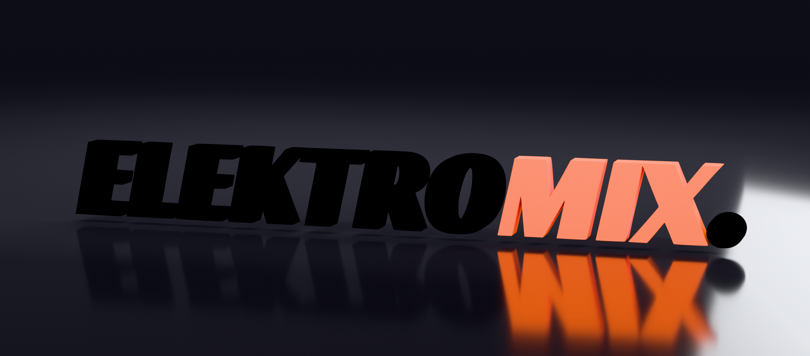

# ELEKTROMIX. — 3D logotype render

A raytraced 3D render of the ELEKTROMIX. logotype, generated from the flat
source scan. Nothing is drawn by hand: the bitmap is vector-traced, extruded
into real geometry, and rendered in Blender Cycles.



## Renders

| File | Description |
| --- | --- |
| `renders/elektromix_3d_hero.png` | Hero shot, dark glossy sweep, 2560×1128 |
| `renders/elektromix_3d_light_studio.png` | Light studio variant, 2560×1128 |
| `renders/elektromix_3d_detail.png` | Three-quarter close-up on the `ROMIX` seam, 2200×978 |

## Pipeline

```
source/elektromix_logo.jpg          the flat scan
        │
        │  trace.py          colour-separate the ink, potrace to outlines
        ▼
logo_black.svg + logo_orange.svg    10 + 2 contours, counters kept as holes
        │
        │  render_logo.py    extrude, bevel, shade, light, raytrace
        ▼
renders/*.png
```

### 1. Tracing (`logo3d/trace.py`)

The scan has three flat colours — ~#F9F9F9 paper, black ink, and #FB6100 orange
ink — so the two ink groups separate with a luma threshold at the paper/ink
midpoint plus a hue test. `ELEKTRO` and the trailing period are black; `MIX` is
orange. The masks are opened by one pixel to drop JPEG speckle, then traced with
potrace.

The black group yields 10 contours: seven letters, the period, and the counters
of `R` and `O`, which stay as holes via the even-odd fill rule. Rerunning the
script reproduces byte-identical path data.

### 2. Rendering (`logo3d/render_logo.py`)

- **Geometry** — the SVG curves are imported, scaled to 10 units wide, stood
  upright, extruded to 0.30 units deep (~24% of cap height) and given a 0.013
  bevel with a 30° angle limit, so every edge catches a highlight. ~13.5k faces.
- **Materials** — Principled BSDF dielectrics. Black is a near-black
  (sRGB 0.058) with a clearcoat for piano-black gloss; orange is the brand
  #FB6100 with only a trace of coat, because a strong white sheen desaturates it.
- **Lighting** — a soft key from upper left, a long thin overhead strip that
  draws the specular line along the top bevels, a narrow grazing panel from the
  right that lights the extruded side walls, a cool rim from behind, a warm low
  bounce, and a broad pool aimed down at the floor behind the mark. All lights
  are hidden from camera rays, so they light and reflect without appearing as
  blobs in frame.
- **Colour management** — `Khronos PBR Neutral`. Under `Standard`, the orange
  clipped its red channel and shifted to yellow; PBR Neutral rolls highlights to
  white without the hue shift.

```bash
pip install bpy pillow numpy potracer

python3 logo3d/trace.py
python3 logo3d/render_logo.py --variant hero --res 2560x1128 --samples 320 \
    --out ../renders/elektromix_3d_hero.png
```

Variants are `hero`, `light` and `detail`. `--gain` scales every light and
`--exposure` overrides the film exposure, which is how the lighting was
calibrated. Cycles renders on CPU here; each final took roughly 20–30 minutes on
4 cores.

### 3. Colour check (`logo3d/check_color.py`)

Because the brand orange is easy to blow out, the renders are checked
numerically rather than by eye: the script samples the orange ink pixels and
reports their median RGB and green/red ratio against the #FB6100 target of
0.386. A lit dielectric picks up white specular and ambient, so an exact match
is not expected — the check exists to catch the yellow/salmon drift that
over-lighting causes, which is how the first passes were found to be wrong.

| Render | Median orange RGB | G/R | Clipped |
| --- | --- | --- | --- |
| hero | 228, 95, 39 | 0.417 | 0.0% |
| light studio | 247, 120, 71 | 0.486 | 0.0% |
| detail | 245, 112, 57 | 0.457 | 0.0% |

The light studio sits highest because a bright environment bounces more white
onto the ink. The close-up needed its camera-facing lights halved (`front=0.5`)
to reach 0.457 — at the hero's levels the same faces, filling the frame,
measured 0.566 and read visibly coral.

```bash
python3 logo3d/check_color.py renders/*.png
```

## Editing

`logo3d/elektromix_3d.blend` is the hero scene as built by the script — open it
to adjust the camera, materials or lighting interactively.

## Also in this repository

`transstructure/` is a separate, dependency-free Python package. It is a
metacognitive control skeleton: a signal feed, processing, self-monitoring,
human oversight and actuation. See [`transstructure/README.md`](transstructure/README.md).
